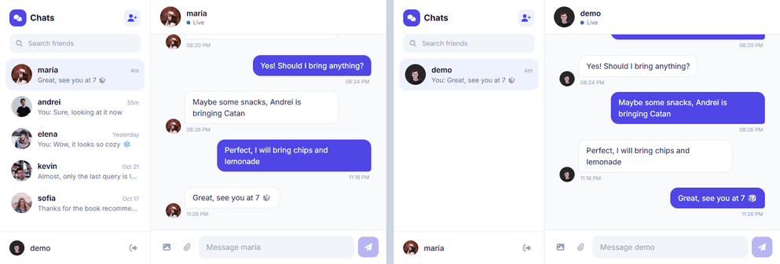
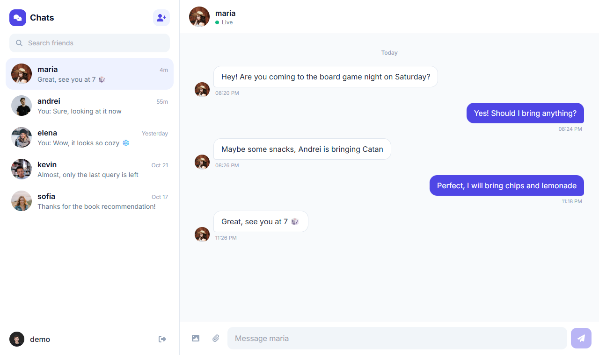
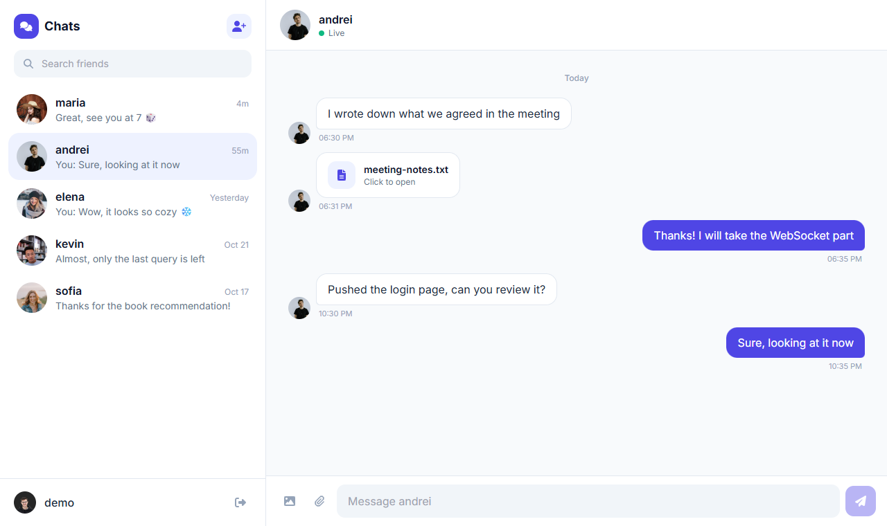
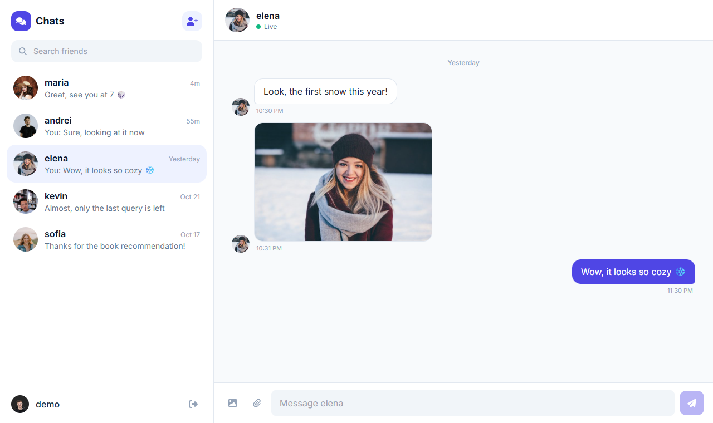
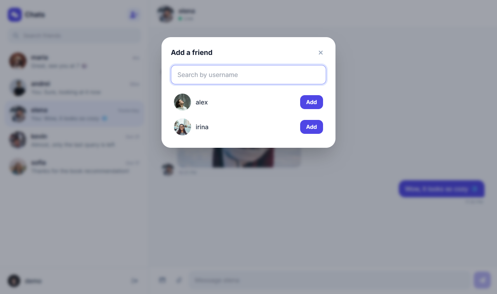
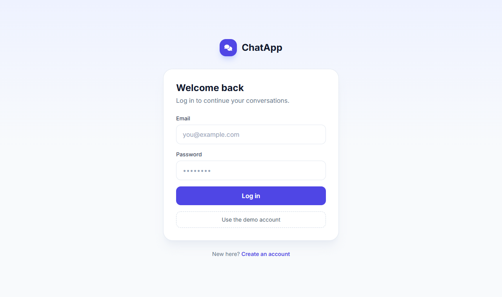
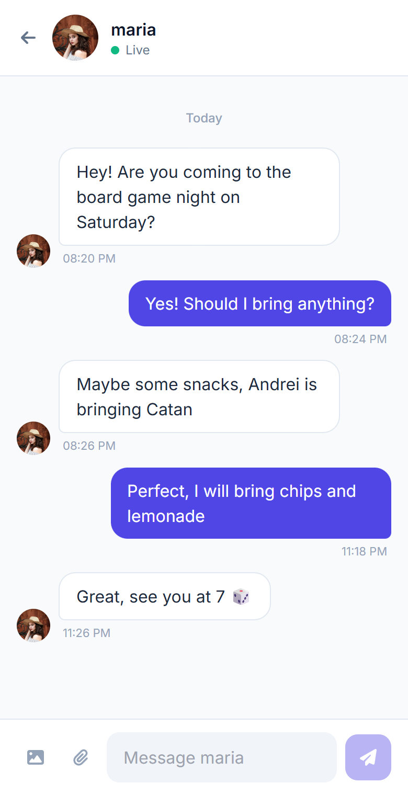

# ChatApp: real-time chat with Django Channels + Next.js

A messaging app where people sign up, add each other as friends and chat in real time. Text messages travel over WebSockets, and photos and files can be shared in the same conversation.



*Two browsers, two accounts: each message shows up on the other side instantly.*

| Conversation | Shared file | Shared photo |
|---|---|---|
|  |  |  |

| Add a friend | Log in | Phone |
|---|---|---|
|  |  |  |

## Features

- **Real-time messaging** over WebSockets (Django Channels). Both people in a conversation join the same channel group, so new messages appear without refreshing.
- **Photos and files** (up to 10 MB). They are uploaded over HTTP and then pushed to the other person through the same WebSocket group.
- **Friends**: search people by username and add them. Adding a friend works both ways and opens a conversation.
- **Conversation list** with the last message, who sent it and how long ago, newest first.
- **Sign up and log in** with email and password, plus an optional profile picture.
- **Token authentication**: every API call and WebSocket connection is tied to the logged-in user. You can only read or write conversations with your friends.
- **Responsive layout**: on a phone you see either the list or the open chat, with a back button.
- **Demo data**: one command creates 8 users with photos and conversations.

## Tech stack

| Layer | Technologies |
|---|---|
| Frontend | Next.js 14 (App Router), React 18, Tailwind CSS, Axios, Font Awesome |
| Backend | Python, Django 5, Django REST Framework, Django Channels, Daphne (ASGI) |
| Realtime | WebSockets, Channels in-memory layer (Redis for multi-server setups) |
| Auth | DRF token authentication, custom user model with email login |
| Database | SQLite by default, MySQL optional |
| Tests | Django test runner, Channels `WebsocketCommunicator` |

## How it works

```
                 REST (Authorization: Token …)
Next.js  ───────────────────────────────────────►  Django REST Framework ──► SQLite / MySQL
(3000)   ◄──────── WebSocket /ws/chat/<friend>/ ───  Django Channels (8000)
                       ?token=…
```

1. Logging in returns a token, which the frontend keeps in `localStorage` and sends with every request.
2. Opening a conversation loads its history over REST and opens a WebSocket for that friend. The server checks the token and the friendship before accepting it.
3. A text message is sent over the socket. The consumer saves it and broadcasts it to the conversation group (`chat_<smaller id>_<bigger id>`), so both people receive it.
4. Photos and files are posted over HTTP (multipart), saved, and broadcast to the same group.

### API

| Method | Endpoint | Description |
|---|---|---|
| POST | `/signup/create-users/` | Create an account (multipart, optional `user_picture`) |
| POST | `/auth/login/` | Email + password → token and user |
| GET | `/auth/me/` | The logged-in user |
| POST | `/auth/log-out/` | Delete the token |
| GET | `/conversation/friends/` | My friends with their last message |
| POST | `/conversation/friends/` | Add a friend (`friendId`) |
| GET | `/conversation/users/?search=` | People I can add |
| GET | `/conversation/?friendUserId=` | Messages with a friend |
| POST | `/conversation/send-image/`, `/send-file/` | Upload and broadcast a photo or file |
| WS | `/ws/chat/<friendId>/?token=` | Live messages for one conversation |

## Getting started

Requirements: Python 3.10+ and Node.js 18+.

**1. Backend**

```bash
cd server
python -m venv venv
venv\Scripts\activate          # macOS/Linux: source venv/bin/activate
pip install -r requirements.txt
python manage.py migrate
python manage.py seed_demo     # demo users and conversations
python manage.py runserver 8000
```

`runserver` uses Daphne, so the same server handles HTTP and WebSockets.

**2. Frontend** (in a second terminal)

```bash
cd client/ChatApp
npm install
npm run dev
```

Open http://localhost:3000 and log in with **demo@chat.app** / **ChatDemo123!** (or click "Use the demo account"). Every demo user has the same password, so you can open a second browser window as `maria@chat.app` and chat with yourself.

**Configuration**

| Variable | Default | Used for |
|---|---|---|
| `DJANGO_SECRET_KEY` | dev key | Django secret key (set it in production) |
| `DEBUG` | `True` | Django debug mode |
| `ALLOWED_HOSTS` | `localhost,127.0.0.1` | Allowed host names |
| `USE_MYSQL` | not set | `True` switches to MySQL (`DB_NAME`, `DB_USER`, `DB_PASSWORD`, `DB_HOST`, `DB_PORT`) |
| `NEXT_PUBLIC_API_URL` | `http://127.0.0.1:8000` | Backend address for the frontend |
| `NEXT_PUBLIC_WS_URL` | `ws://127.0.0.1:8000` | WebSocket address for the frontend |

**Tests**

```bash
cd server
python manage.py test
```

There are 15 tests covering sign-up, login, permissions, friends, uploads, and WebSocket delivery and access rules.

## Project structure

```
client/ChatApp/src/
  app/              pages: chat (/), /login, /signup
  components/       Sidebar, ChatWindow, AddFriendModal, Avatar, AuthCard
  lib/              API client (token handling), time formatting
server/
  ChatApp/          settings, ASGI routing, WebSocket token middleware
  signup/           custom user model, sign-up
  login/            login, logout, current user
  conversation/     friends, messages, uploads, WebSocket consumer, tests
  demo/             avatars and files used by seed_demo
```

## What I would add next

- Unread message counters and notifications for conversations that are not open
- Typing indicators and read receipts over the same WebSocket
- Group conversations
- Redis channel layer and cloud file storage for deployment
